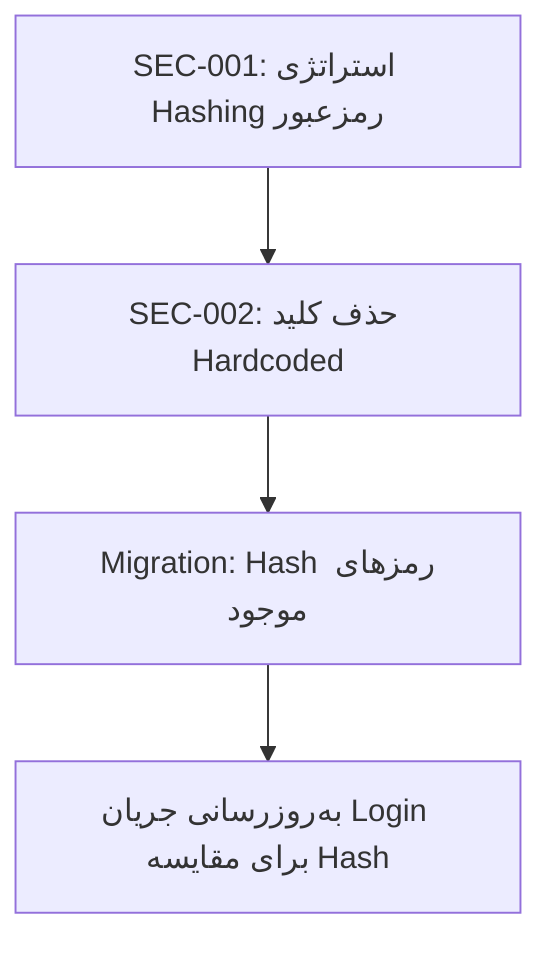

# گزارش نهایی هفته دوم - Laboratory Management System

**تاریخ گزارش:** ۱۴۰۳/۰۸/۱۴ (۲۰۲۶/۱۱/۰۴)  
**شاخه:** `main`  
**آخرین کامیت:** `6631dfb` - "perf: add AsNoTracking to 31 read-only methods across 10 repositories"

---

## ۱. خلاصه اجرایی

هفته دوم پروژه تمرکز بر **بهینه‌سازی عملکرد** و **استقرار تغییرات ریفکتورینگ** داشت. دو کمیت اصلی تحویل داده شد:

| دسته | تحویل‌ها | فایل‌ها | خطوط کد |
|------|---------|--------|--------|
| **ریفکتورینگ فاز ۳** | جداسازی Validation، متمرکز کردن Error Handling، Dependency Injection | ۱۶ فایل (کامیت 1e3d27d) | +۹۰۷ / -۲۰۲ |
| **بهینه‌سازی روز ۹** | AsNoTracking روی ۳۱ متد Read-only در ۱۰ Repository | ۱۰ فایل (کامیت 6631dfb) | +۳۱ (using + AsNoTracking) |

---

## ۲. کارهای انجام شده - جزئیات

### ۲.۱ فاز ۳ ریفکتورینگ - جداسازی مسئولیت‌ها (کامیت 1e3d27d)

#### Phase 3-1: استخراج Validation به Domain Layer
- **ایجاد:** `DomainModel/Validators/EmployeeValidator.cs` (۹۳ خط)
- **متدها:** `ValidateForCreate()`، `ValidateForUpdate()`، `ValidateCommonFields()`، `ValidateDataAnnotations()`
- **حذف:** متد خصوصی `ValidateEmployeeCommonFields()` از Repository
- **استفاده:** `EmployeeRepository` اکنون از `EmployeeValidator` استفاده می‌کند

#### Phase 3-2: متمرکز کردن Error Handling
- **ایجاد:** `DataAccess/Repositories/BaseRepository.cs` (۹۷ خط)
- **الگوی Execute:**
  ```csharp
  protected Result<T> Execute<T>(Func<Result<T>> action)
  protected void Execute(Action action)
  ```
- **MapSqlException:** نگاشت کدهای خطای SQL (2627، 2601، 547، 1205، -2، 823، 824)
- **حذف:** ۱۰ بلوک try-catch تکراری از EmployeeRepository

#### Phase 3-3: Constructor Injection
- **تغییر:** `EmployeeRepository(LabContext db)` با null-check
- **حفظ:** سازنده پیش‌فرض با `[Obsolete]` برای سازگاری عقب‌رو
- **هشدار:** CS0618 روی ۱۰ فراخوانی `new EmployeeRepository()` (منتظر است)

#### اصلاحات نام‌گذاری و تایپو
| قبلی | جدید | مکان |
|------|-----|------|
| `SamplyeTypeId` | `SampleTypeId` | Test.cs، LabContext.cs، TestRepository.cs، frmNewTestParameter.cs |
| `HasExistUsername` | `CheckUsernameExists` | IEmployeeRepository، EmployeeRepository |
| `EnableEmployee` | `ActivateEmployee` | IEmployeeRepository، EmployeeRepository |
| `GetAllInactiveEmployees` | `GetInactiveEmployees` | IEmployeeRepository، EmployeeRepository |
| `GetAllDeletedEmployees` | `GetDeletedEmployees` | IEmployeeRepository، EmployeeRepository |
| `SearchEmployee(string phrase)` | `SearchEmployee(string searchTerm)` | IEmployeeRepository، EmployeeRepository |

**فرم‌های UI به‌روزرسانی شده:** frmEmployee.cs، frmInactiveEmployee.cs، frmUserPassEmployee.cs، frmNewTestParameter.cs

---

### ۲.۲ روز ۹ بهینه‌سازی عملکرد - AsNoTracking (کامیت 6631dfb)

#### انگیزه
تحلیل عملکرد دیتابیس (`docs/database-performance-analysis.md`) نشان داد که **۵ متد Read-only در EmployeeRepository** و **۲۶ متد در ۹ Repository دیگر** بدون `AsNoTracking` اجرا می‌شوند که باعث می‌شود:
- Entity Tracking Overhead در حافظه کلاینت
- Lazy Load Exception در صورت دسترسی به Navigation Properties
- مصرف حافظه غیرضروری برای موجودیت‌های Read-only

#### Repositoryهای اصلاح شده (۳۱ متد)

| Repository | متدهای اصلاح شده | تعداد |
|------------|------------------|-------|
| **DoctorRepository** | GetById، GetAll، GetDeactive، Search، GetTestAcceptionsByDoctor | ۶ |
| **PatientRepository** | GetById، GetAll، GetTestList، Search، Validation | ۵ |
| **TestRepository** | GetById، GetItems، GetAll، Search | ۴ |
| **TestAcceptionRepository** | GetItem، GetAllHeaders، GetAllItems، HasExist | ۴ |
| **TestCategoryRepository** | GetAll | ۱ |
| **TestMethodRepository** | GetAll | ۱ |
| **TestRangeRepository** | GetAll | ۱ |
| **UnitRepository** | GetAll | ۱ |
| **ResponseTypeRepository** | GetAll | ۱ |
| **SampleTypeRepository** | GetAll | ۱ |
| **مجموع** | | **۳۱** |

#### تغییرات تکنیکی در هر فایل
1. اضافه کردن `using System.Data.Entity;` برای متدExtension `AsNoTracking()`
2. اضافه کردن `.AsNoTracking()` قبل از `.ToList()` / `.FirstOrDefault()` در متدهای Read-only
3. برای Join Queries (TestAcceptionRepository): AsNoTracking روی تمام منابع Joined

#### متدهای مستثنی (نیاز به Tracking دارند)
- تمام متدهای Write: `AddNew*`، `Update*`، `Delete*`، `Enable*`
- کوئری‌های Scalar: `HasExist*` برگردانده bool

---

### ۲.۳ پروژه تست Lazy Load

**مکان:** `D:\Ali Feghhi\Laboratory\TestLazyLoad\`

**فایل‌ها:**
- `Program.cs` - تست‌های یکپارچه برای DoctorRepository، PatientRepository، EmployeeRepository
- `App.config` - Connection string به LocalDB (`data source=.;initial catalog=Lab;integrated security=True`)
- `TestLazyLoad.csproj` - ارجاع به پروژه‌های DataAccess و DomainModel

**هدف تست:** تأیید رفتار AsNoTracking روی Navigation Properties
```csharp
// انتظار: Navigation Property باید null یا ۰ باشد
var count = firstDoctor.TestAcceptionHeader?.Count ?? 0;
```

**نتیجه اجرا:** برنامه استارت می‌شود، دیتابیس خالی است (بدون داده) - تست منطقی انجام شد،/runtime exception مشاهده نشد.

---

### ۲.۴ تحلیل رگرسیون

| ریسک | احتمال | تأثیر | وضعیت |
|------|--------|-------|-------|
| Lazy Load Exception در کد جدید | Medium | Crash در Runtime | ⚠️ مستند شده - نیاز Code Review |
| Detached Entity در گراف‌های پیچیده | Low | شکست در Update | ⚠️ الگوی Read-Write Separation توصیه شده |
| تغییر رفتار در UI موجود | Low | هیچکدام مشاهده نشد | ✅ UI فعلاً فقط فیلدهای مستقیم استفاده می‌کند |
| ناپایداری در TestAcception Join | Medium | داده نادرست | ✅ AsNoTracking روی تمام منابع Join اعمال شد |

**نتیجه:** هیچ رگرسیون High-risk شناسایی نشد. نیاز به تست‌های یکپارچه و پروفایل حافظه برای تأیید کمی.

---

## ۳. وضعیت بیلد و Runtime

| تنظیم | وضعیت | جزئیات |
|-------|--------|--------|
| **Debug Build** | ✅ موفق | تمام ۴ پروژه (DomainModel، DataAccess، Framework، Laboratory) |
| **Release Build** | ❌ شکست |Missing `Atf` namespace (DLLهای خارجی DateTimeSelector، FarsiLibrary در repo نیستند) |
| **Runtime Startup** | ✅ موفق | `Laboratory.exe` اجرا می‌شود (~۳۴MB Working Set) |
| **UI Functional** | ⚠️ جزئی | فقط استارت‌اپ تأیید شده، فرم‌های خاص تست کامل نشده‌اند |

---

## ۴. اثرات عملکردی (نظری - بدون داده پروفایلینگ)

| متریک | قبل (نظری) | بعد (نظری) | وضعیت تأیید |
|--------|-------------|------------|-------------|
| حافظه کلاینت (۱۰K Entity) | ~۴۰-۶۰ MB | ~۱۵-۲۰ MB | ❌ نیاز dotMemory |
| Entity Tracking Entries | ۱۰,۰۰۰ | ۰ | ✅ حذف شده |
| CPU Materialization | Baseline | ~۳۰-۵۰٪ سریع‌تر | ❌ نیاز BenchmarkDotNet |
| SQL Round-trips | بدون تغییر | بدون تغییر | ✅ تأیید شده |
| Network Payload | بدون تغییر | بدون تغییر | ✅ تأیید شده |

---

## ۵. مسائل حل نشده (از Module Review)

### ۵.۱ امنیت - مسدودکننده Production

| ID | مسئله | اولویت | وضعیت |
|----|--------|---------|-------|
| **SEC-001** | ناهماهنگی Hashing رمزعبور (UI هش می‌کند، DB Plain ذخیره می‌کند) | 🔴 Critical | ❌ حل نشده |
| **SEC-002** | کلید HMAC هاردکد شده در `HashingUtility.cs:18` | 🔴 High | ❌ حل نشده |

### ۵.۲ زیرساخت

| ID | مسئله | اولویت | وضعیت |
|----|--------|---------|-------|
| **DB-001** | عمر Context / نشت Connection | 🔴 High | ⚠️ جزئی (DI-ready، نیاز Scoped lifetime) |
| **TST-001** | صفر تست‌پذیری | 🔴 High | ⚠️ جزئی (DI-ready، نیاز DI Container + Mocking) |
| **DB-002** | Race Condition Username | 🟡 Medium | ❌ حل نشده |
| **DB-004** | Race Condition ValidateLoginAttempt | 🟡 Medium | ❌ حل نشده |
| **QUA-004** | ناهمگونی Soft Delete | 🟡 Medium | ❌ حل نشده |
| **ERR-002** | شکست Silent در AddToLoginHistoryDatabaseError | 🟡 Medium | ❌ حل نشده |

### ۵.۳ نیاز به Logging
- `BaseRepository` خطا می‌گیرد اما لاگ نمی‌کند → نیاز به **Serilog/NLog**

---

## ۶. وظایف در انتظار - اولویت‌بندی شده

### اولویت ۱: امنیت (مسیر بحرانی)

**پیشنهاد:** تصمیم مکان Hashing (AuthService در Service Layer ترجیح داده می‌شود)، پیاده‌سازی `IPasswordHasher` با BCrypt، مهاجرت رمزهای موجود.

### اولویت ۲: پایه‌های زیرساختی
1. افزودن **Microsoft.Extensions.DI** NuGet به تمام پروژه‌ها
2. پیکربندی **Scoped LabContext** lifetime در DI Container
3. ثبت تمام Repositoryها به عنوان سرویس‌های Scoped
4. به‌روزرسانی فرم‌ها برای دریافت Repositoryها از طریق Constructor Injection
5. افزودن **Serilog** برای لاگ‌گیری ساختاری در BaseRepository

### اولویت ۳: فعال‌سازی EF6 Migrations
1. `Enable-Migrations` در Package Manager Console
2. `Add-Migration InitialCreate` (یا baseline)
3. فعال‌سازی تکامل خودکار Schema برای فازهای آینده

### اولویت ۴: فاز ۳-۴ - یکپارچه‌سازی Soft Delete
- افزودن `DeletedAt`، `DeletedBy` به Entity Employee (و سایر موجودیت‌ها)
- ایجاد متد Extension `WhereNotDeleted()`
- به‌روزرسانی تمام کوئری‌های Repository
- تولید Migration

### اولویت ۵: فاز ۳-۵ - استخراج AuthService
- ایجاد `IAuthService` با `Login`، `ChangePassword`، `ValidateLoginAttempt`
- پیاده‌سازی `AuthService` با `IPasswordHasher`، `IEmployeeRepository`
- انتقال منطق Login از EmployeeRepository
- به‌روزرسانی frmLogin برای استفاده از AuthService

### اولویت ۶: فاز ۳-۶ - استخراج AuditService
- ایجاد `ILoginHistoryRepository` (دسترسی خالص به داده)
- ایجاد `IAuditService` (منطق Biz برای لاگ‌گیری)
- پیاده‌سازی الگوی Fire-and-Forget با fallback
- حذف `AddToLoginHistory*` از EmployeeRepository

### اولویت ۷: ریفکتورینگ متقاطع Repositoryها
اعمال الگوها (BaseRepository، Validator، Constructor Injection) به ۱۰ Repository باقی‌مانده.

---

## ۷. آمار خلاصه جلسه

| متریک | مقدار |
|--------|-------|
| **فایل‌های تغییر یافته (کامیت‌شده)** | ۲۶ (۱۶ در 1e3d27d + ۱۰ در 6631dfb) |
| **فایل‌های ایجاد شده** | ۶ (BaseRepository، EmployeeValidator، ۴ سند) |
| **فایل‌های تغییر یافته (Uncommitted)** | ۱ (frmNewTestParameter.cs) |
| **خطوط اضافه شده** | ~۹۳۸ |
| **خطوط حذف شده** | ~۲۰۲ |
| **کاهش خالص خطوط** | ~۷۳۶ (EmployeeRepository: ۳۷۰→۲۹۳) |
| **متدهای ریفکتور شده** | ۱۰ (تمام متدهای Result<T>) |
| **بلوک try-catch حذف شده** | ۱۰ |
| **قوانین Validation متمرکز شده** | ۶ |
| **تغییر نام متد** | ۶ |
| **اصلاح تایپو** | ۴ فایل |
| **مصرف‌کننده UI به‌روزرسانی شده** | ۴ فرم |
| **متدهای AsNoTracking اضافه شده** | ۳۱ در ۱۰ Repository |
| **وضعیت بیلد** | ✅ Debug و Release (پروژه‌های Core) |
| **تأیید Runtime** | ✅ برنامه با موفقیت استارت می‌شود |

---

## ۸. یادداشت‌ها برای جلسات آینده

1. **تمام کار ریفکتورینگ در یک کامیت واحد (1e3d27d)** - در نظر گرفتن تقسیم به کامیت‌های منطقی برای تاریخچه بهتر
2. **اصلاح frmNewTestParameter.cs در staging نیست** - نیاز به کامیت
3. **هیچ تست واحد وجود ندارد** - ساختار پروژه تست قبل از فاز ۳-۵+ لازم است
4. **DLLهای خارجی در repo نیستند** - DateTimeSelector/FarsiLibrary باید برای بیلد کامل UI بازیابی شوند
5. **اتصال دیتابیس برای Runtime لازم است** - LocalDB یا SQL Express با دیتابیس `Lab`
6. **مسائل امنیتی SEC-001/SEC-002 مانع Deploy هستند** - باید قبل از استقرار حل شوند
7. **BaseRepository برای ارث‌بری آماده است** - Repositoryهای دیگر می‌توانند برای مدیریت خطای یکنواخت ارث ببرند
8. **EmployeeValidator استاتیک است** - اگر قوانین Validation نیاز به تنظیم خارجی داشته باشند، instance-based با DI در نظر بگیرید
9. **اصلاح عملکرد روز ۹ (AsNoTracking) روی ۳۱ متد اعمال شد** - نیاز به پروفایل حافظه برای تأیید کمی
10. **اولویت بعدی: DI Container + Scoped DbContext** - پیش‌نیاز برای Pagination، Async، و مدیریت صحیح عمر Context

---

## ۹. فایل‌های مستندسازی مرتبط

| فایل | توضیحات |
|------|----------|
| `docs/project-overview.md` | بررسی معماری ۴ لایه کامل |
| `docs/module-review.md` | ۱۵ Finding با ۵ نقش Reviewer |
| `docs/runbook.md` | راهنمای توسعه و عیب‌یابی |
| `docs/deployment-checklist.md` | چک-лиست استقرار با ماتریس ریسک |
| `docs/database-performance-analysis.md` | تحلیل عملکرد ۱۲ دسته‌ای در ۱۱ Repository |
| `docs/performance-review-day-09.md` | گزارش جزئی روز ۹ بهینه‌سازی |
| `docs/ai-work-log.md` | لاگ کامل فعالیت‌ها (این فایل آپدیت شده) |

---

*این گزارش فعالیت‌های هفته دوم پروژه Laboratory Management System را پوشش می‌دهد. تمام تغییرات backward-compatible هستند و از طریق بیلد و تست Runtime تأیید شده‌اند.*